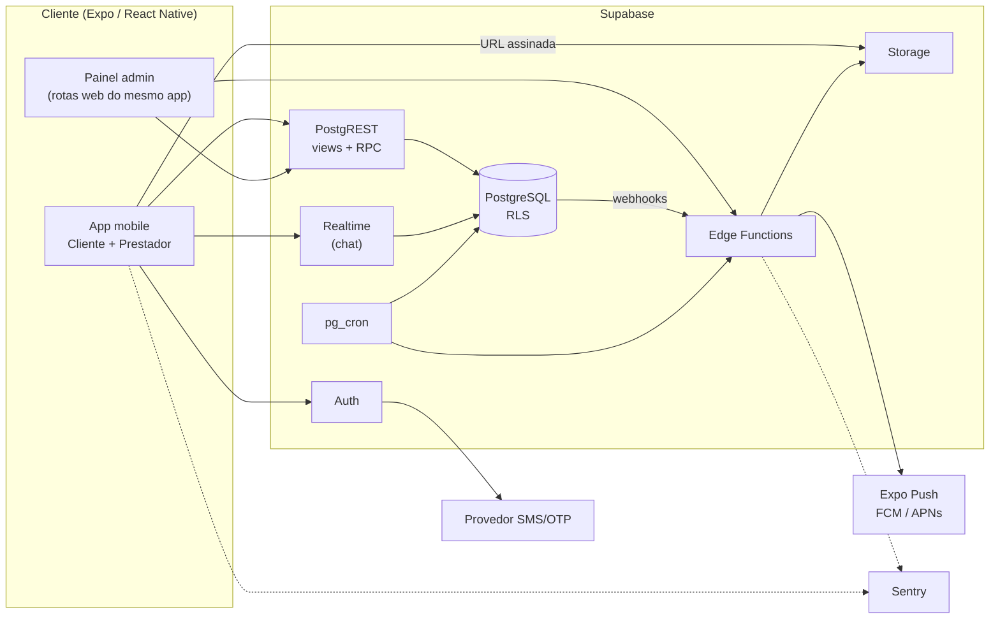
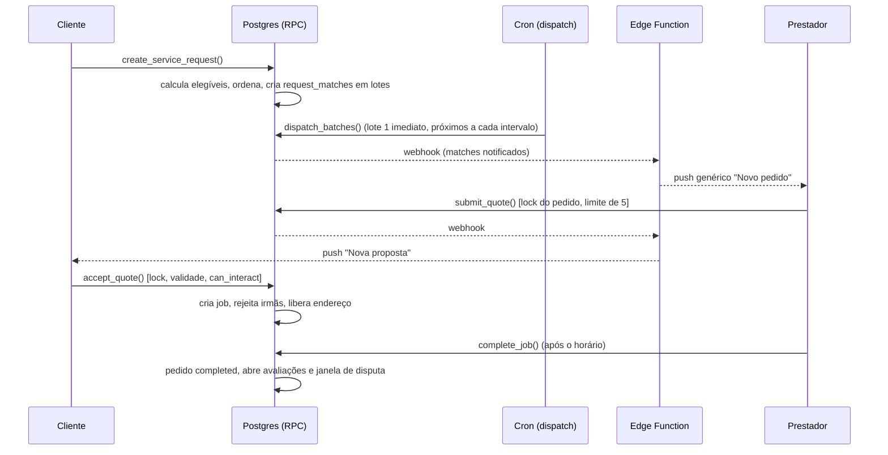

# ARCHITECTURE — Arquitetura Técnica

> Status: **Revisado pela auditoria (v2), pendente de aprovação**. Alterações novas: **[PENDENTE DE APROVAÇÃO]**. Ver [AUDIT_REPORT.md](AUDIT_REPORT.md).

## 1. Avaliação da stack

| Tecnologia | Veredito | Observações |
|---|---|---|
| React Native + Expo + TypeScript | **Manter** | Uma base para Android e iOS. Ideal para uma pessoa só |
| Expo Router | **Manter** | Rotas por arquivo. Exporta web para o painel admin |
| Supabase (Postgres, Auth, Storage, Realtime) | **Manter** | Banco, auth, arquivos e chat sem backend próprio |
| Git + GitHub | **Manter** | GitHub Actions para tipos, lint, testes |
| **PostGIS** | **Adiar** | Bairros em lista não exigem geoprocessamento |
| **Backend próprio** | **Não adotar** | RPC + Edge Functions bastam. Revisitar se a lógica crescer |
| **UI library** | **Não adotar** | Tokens próprios |
| **Admin separado (Next.js)** | **Não adotar no MVP** | Rotas web do mesmo app, restritas a admin |
| TanStack Query, Zod | Usar | Cache de servidor e validação compartilhada |

### Problemas conhecidos e tratamento

1. **Free tier pausa e não tem backup diário:** plano Pro antes do piloto aberto.
2. **RLS mal escrita vaza dados:** RLS em toda tabela, **matriz de permissões testada célula a célula** (DATABASE seção 7, TEST_STRATEGY seção 2).
3. **Regra no cliente é burlável:** toda transição em RPC `SECURITY DEFINER` ou Edge Function.
4. **Push no iOS** exige conta Apple paga e APNs. Android exige FCM.
5. **Expo Go não cobre tudo:** development builds (EAS) desde cedo.
6. **Selfie/documentos:** bucket privado estrito, upload por URL assinada, leitura só por admin com URL de 60 s.
7. **Admin via Expo Router web:** UX básica, aceitável para um operador. **Risco:** operador único, sem revisão por segunda pessoa (AUDIT_REPORT, riscos remanescentes).
8. **Lock-in:** SQL padrão versionado no repositório.
9. **Crons dependem de `pg_cron`/Edge Functions:** jobs idempotentes e expiração preguiçosa nas RPC (o sistema não pode depender de o cron ter rodado).
10. **Hot path com `FOR UPDATE`:** volume do piloto é baixo e comporta. Ordem de lock fixa evita deadlock.

## 2. Visão geral

## 3. Separação de responsabilidades

| Camada | Responsabilidade |
|---|---|
| **App** | Apresentação, validação de UX, cache. **Nunca** é fonte de verdade |
| **Banco** (RLS, constraints, RPC, `can_interact`) | Autorização, integridade, máquinas de estado, concorrência |
| **Edge Functions** | Efeitos externos (push), operações administrativas, URLs assinadas, hash de CPF, exclusão de conta |
| **pg_cron** | Despacho em lotes, expiração, revelação de avaliações, purga |

Estrutura de pastas planejada (referência, não criar ainda): `/app` (grupos `(auth)`, `(customer)`, `(provider)`, `(admin)`), `/src/features/*`, `/src/lib`, `/src/ui`, `/src/schemas`, `/supabase/migrations`, `/supabase/functions`, `/supabase/tests`, `/docs`.

## 4. Autenticação e autorização

- Supabase Auth: e-mail + senha. OTP de telefone.
- **Perfis cliente/prestador são dados**, não papéis de autenticação.
- `admin` em `admin_users` (escrita manual). Todas as operações admin exigem **MFA (aal2)**.
- Matriz completa de permissões por tabela, view e bucket: [DATABASE.md](DATABASE.md) seção 7.
- `can_interact(a, b)` centraliza bloqueio/suspensão (DATABASE seção 6).

## 5. Fluxo crítico (pedido → proposta → job)

## 6. Matching e distribuição

Premissa: a regra anterior ("entregar a todos os elegíveis") causava ruído e favorecia quem abre o app primeiro. A distribuição agora é **em lotes**. Parâmetros são `app_config` e **[PENDENTE DE APROVAÇÃO]**.

### 6.1 Elegibilidade (todas obrigatórias)

1. `verification_status = approved` e `profiles.status = active`.
2. `is_paused = false`.
3. Presente em `provider_categories` para a categoria do pedido, **e** a categoria `is_active`.
4. Presente em `provider_neighborhoods` para o bairro do pedido.
5. **Disponibilidade:** existe ao menos um dia da janela `[window_start, window_end]` (fuso `America/Sao_Paulo`) cujo `weekday` + `period` está em `availability_rules`. Períodos: manhã 06–12, tarde 12–18, noite 18–22. **Sem regras = inelegível.**
6. `can_interact(cliente, prestador)` verdadeiro (nenhum bloqueio em nenhuma direção).
7. **Prestador ≠ cliente** (mesma conta com dois perfis nunca recebe o próprio pedido).
8. Sem excesso de pendências: prestador com mais de `provider_max_pending_quotes` propostas `sent` simultâneas fica fora de novos lotes **[PENDENTE DE APROVAÇÃO]**.

### 6.2 Ordenação (distribuição equilibrada) [PENDENTE DE APROVAÇÃO]

Dentro do conjunto elegível, ordenar por:
1. **Menos pedidos recebidos nos últimos 7 dias** (`request_matches.notified_at`), para dar chance a quem recebeu menos.
2. Maior taxa de resposta (propostas enviadas ÷ pedidos notificados) em 30 dias, com valor neutro para novos prestadores.
3. Maior nota (neutra para quem tem poucas avaliações).
4. Desempate aleatório.

Sem componente pago. Sem preferência por quem responde mais rápido (evita corrida).

### 6.3 Lotes

| Parâmetro | Valor proposto |
|---|---|
| `batch_size` | 8 prestadores |
| `batch_interval_minutes` | 15 |
| Lote 1 | Imediato |
| Próximo lote | Se `active_quotes_count < max_quotes`, pedido `open` e `now < expires_at` |
| Fim do despacho | Elegíveis esgotados, pedido `quotes_closed`, `hired`, cancelado ou expirado |

- Se há ≤ `batch_size` elegíveis, **todos** são notificados no lote 1 (típico do piloto).
- Vagas: `max_quotes = 5`. Prestador notificado vê "restam X vagas".
- Cada prestador tem teto de push por dia (`push_daily_cap`, proposto 10). Excedido vira apenas notificação no app.
- Janela silenciosa de push (ex.: 21h–7h) **[PENDENTE DE APROVAÇÃO]**.
- `request_matches` guarda `batch_no` e `eligibility_snapshot` (explicável em disputa de "não recebi o pedido").
- Sem rematch retroativo: prestador aprovado depois não recebe pedido já despachado.

### 6.4 Concorrência

- `submit_quote`: `SELECT … FOR UPDATE` no pedido, revalida status/vagas/validade/duplicidade dentro do lock.
- `accept_quote`, `withdraw_quote`, `expire_*`, `cancel_*`: mesma ordem de lock (pedido → proposta → job), tornando corridas determinísticas. Teste obrigatório (TEST_STRATEGY).
- Cron: `FOR UPDATE SKIP LOCKED`, idempotente.
- Índice único parcial garante no banco "um aceito por pedido", independentemente da aplicação.

### 6.5 Sem elegíveis

Pedido nasce `expired` (`no_eligible_providers`), registrado em `unserved_demand`. O cliente é informado com honestidade, com opção "Avise-me" **[PENDENTE DE APROVAÇÃO]**.

## 7. Armazenamento

Detalhes e políticas: DATABASE seção 7.1.

| Bucket | Visibilidade | Conteúdo |
|---|---|---|
| `avatars` | Público | Fotos de perfil |
| `portfolio` | Público | Fotos de portfólio |
| `request-media` | Privado | Fotos do pedido. Visível ao cliente, a prestadores com match ativo e ao contratado. **Aviso ao cliente**: as fotos podem ser vistas por vários prestadores antes da contratação. EXIF removido |
| `verification` | **Privado estrito** | Documento e selfie. Upload por URL assinada. Leitura apenas por admin via URL de 60 s. Purga automática (SECURITY seção 4.3) |

## 8. Notificações

- `push_tokens` por dispositivo. Webhook de banco → `send-push` → Expo Push.
- Conteúdo **genérico** (sem nome, endereço, valor ou texto de mensagem) por causa da tela de bloqueio.
- `send-push` aplica `can_interact`, teto diário e remoção de tokens inválidos.
- Central de notificações lê `notifications` (retenção 90 dias).

## 9. Observabilidade

- Sentry no app e Edge Functions, sem PII nos eventos.
- `status_events` (negócio) e `admin_audit_log` (administração) como trilhas de auditoria.
- Painel simples no admin para execução dos crons (última execução, falhas).

## 10. Ambientes

Local (Supabase CLI), Staging (projeto separado, sem dados reais), Produção (Pro). Migrações só por CLI.

## 11. Escalabilidade e evolução

1 cidade e centenas de usuários: folga ampla. Expansão: `cities`, PostGIS, raio. Se RPC/EF crescerem demais, extrair serviço (a camada de RPC já isola a lógica). Pagamento futuro: Edge Function + provedor tokenizado.

## 12. Registro de decisões arquiteturais (ADR)

Status: **Aceita** = decisão do proprietário ou herdada do escopo aprovado. **Proposta** = [PENDENTE DE APROVAÇÃO].

| ADR | Decisão | Motivo | Consequência | Status |
|---|---|---|---|---|
| 01 | Supabase como backend inicial | Uma pessoa, velocidade, RLS | Lock-in moderado | Aceita |
| 02 | Sem backend próprio | Menos infraestrutura | Lógica em RPC/EF | Aceita |
| 03 | Sem PostGIS no MVP | Área por bairros | Migrar na expansão | Aceita |
| 04 | Admin no mesmo app Expo (web) | Uma stack | UX básica | Aceita |
| 05 | Um usuário, dois perfis como dados | Evita contas duplicadas | Tabelas separadas | Aceita |
| 06 | Máquina de estados no banco, com `status_events` | Segurança, consistência, auditoria | Mais SQL | Aceita |
| 07 | Documentos em bucket privado, URL assinada | LGPD | Admin passa por EF | Aceita (detalhada na v2) |
| 08 | Sentry como única ferramenta extra | Diagnóstico | Dependência externa | Aceita |
| 09 | Monetização adiada | Validar demanda | Esquema independe de pagamento | Aceita |
| 10 | TanStack Query + Zod | Cache e validação | Duas dependências | Aceita |
| 11 | `profiles` sem FK física para `auth.users`; exclusão remove `auth.users` e anonimiza `profiles` | Preservar integridade de jobs/avaliações/denúncias após exclusão | Consistência garantida por trigger e teste | **Proposta** |
| 12 | Despacho em lotes com ordenação equilibrada | Evitar ruído e favorecimento de quem responde primeiro | Mais lógica de cron e `request_matches` mais rico | **Proposta** |
| 13 | Função única `can_interact` para bloqueio/suspensão | Evitar buracos por esquecimento em uma RPC | Toda RPC bilateral deve usá-la (verificado por teste) | **Proposta** |
| 14 | Expiração preguiçosa + cron de consolidação | Correção não depende da pontualidade do cron | RPC comparam `now()` | **Proposta** |
| 15 | Upload de verificação por URL assinada, sem política de INSERT/SELECT direta | Reduz superfície de vazamento | Fluxo de upload via EF | **Proposta** |
| 16 | CPF armazenado só como HMAC (sem CPF em claro) | Minimização LGPD | Sem possibilidade de recuperar o CPF | **Proposta** |
| 17 | Admin lê conversa/mídia só com denúncia vinculada, via EF auditada | Privacidade | Menos conveniência operacional | **Proposta** |
| 18 | Tabela `status_events` append-only | Disputa e auditoria | Escrita extra por transição | **Proposta** |
| 19 | `consent_records` append-only substitui campos de aceite em `profiles` | Prova de consentimento LGPD | Tabela nova | **Proposta** |
