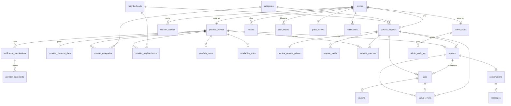
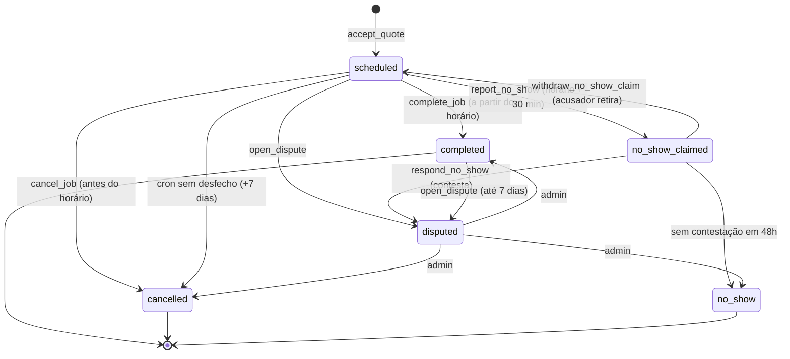
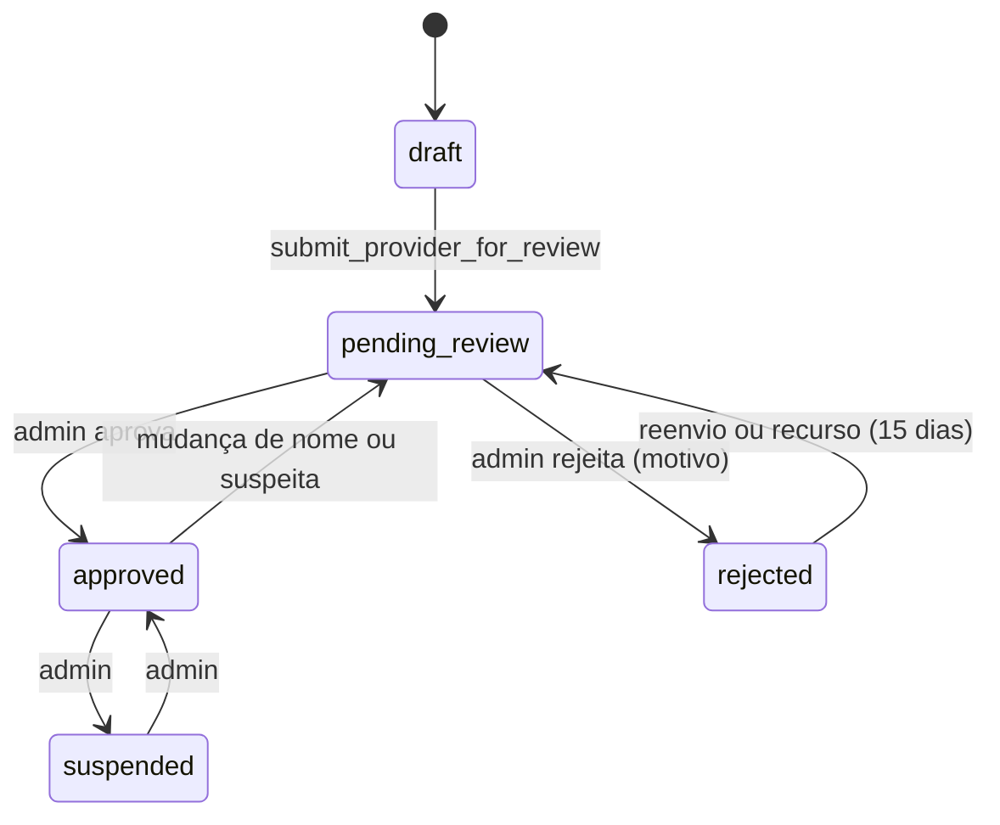

# DATABASE — Modelagem de Dados

> Status: **Revisado pela auditoria (v2), pendente de aprovação**. Sem DDL: o SQL será escrito na implementação a partir deste documento.
> Itens novos ou alterados que dependem do proprietário estão marcados **[PENDENTE DE APROVAÇÃO]**. Ver [AUDIT_REPORT.md](AUDIT_REPORT.md).
> Convenções: chaves `uuid`; `created_at`/`updated_at` em `timestamptz` (trigger); dinheiro em **centavos** (`integer`); fuso de negócio `America/Sao_Paulo`; nomes em inglês `snake_case`. Parâmetros numéricos vêm de `app_config` (ver PRD seção 11).

## 1. Diagrama

## 2. Catálogo de enums

| Enum | Valores |
|---|---|
| `profile_status` | `active`, `suspended`, `deleted` |
| `verification_status` (em `provider_profiles`) | `draft`, `pending_review`, `approved`, `rejected`, `suspended` |
| `submission_type` | `initial`, `resubmission`, `appeal` |
| `submission_status` | `pending`, `approved`, `rejected` |
| `document_type` | `id_front`, `id_back`, `selfie` |
| `rejection_reason` | `illegible`, `expired_document`, `face_mismatch`, `name_mismatch`, `underage`, `duplicate_account`, `suspected_fraud`, `incomplete` |
| `request_status` | `open`, `quotes_closed`, `hired`, `completed`, `cancelled`, `expired` |
| `request_status_reason` | `no_eligible_providers`, `no_acceptance_in_time`, `client_cancelled`, `job_cancelled`, `job_no_show`, `no_outcome`, `moderation_removed`, `account_deleted` |
| `quote_status` | `sent`, `accepted`, `rejected`, `withdrawn`, `expired` |
| `quote_status_reason` | `sibling_accepted`, `request_cancelled`, `request_expired`, `validity_expired`, `provider_withdrew`, `provider_suspended`, `moderation_removed`, `account_deleted` |
| `job_status` | `scheduled`, `no_show_claimed`, `completed`, `cancelled`, `no_show`, `disputed` |
| `completion_type` | `full`, `partial` |
| `cancel_reason` | `schedule_conflict`, `no_longer_needed`, `price_disagreement`, `found_other_provider`, `provider_unavailable`, `safety_concern`, `other` |
| `conversation_status` | `open`, `read_only` |
| `review_status` | `pending_reveal`, `published`, `removed` |
| `report_target` | `user`, `review`, `message`, `request`, `quote`, `job` |
| `report_reason` | `harassment`, `threat_or_violence`, `fraud`, `fake_profile`, `inappropriate_content`, `no_show`, `price_divergence`, `incomplete_service`, `damage_or_theft`, `spam`, `other` |
| `report_status` | `open`, `in_review`, `resolved`, `dismissed` |
| `dispute_outcome` | `completed`, `cancelled`, `no_show_client`, `no_show_provider` |
| `availability_period` | `morning` (06–12), `afternoon` (12–18), `evening` (18–22) |

## 3. Tabelas

Legenda de `ON DELETE`: **R** = RESTRICT, **C** = CASCADE, **N** = SET NULL. Contas **nunca** são apagadas fisicamente das tabelas de negócio. São anonimizadas (seção 8).

### 3.1 Identidade

**profiles**
| Campo | Tipo | Notas |
|---|---|---|
| id | uuid PK | **Mesmo valor** de `auth.users.id`. Sem FK física para `auth.users` (exceção documentada, ADR-11 **[PENDENTE DE APROVAÇÃO]**): permite apagar o usuário de autenticação preservando o perfil anonimizado. Criação por trigger de signup. Teste de consistência no CI |
| full_name | text | obrigatório. Anonimizado na exclusão |
| avatar_path | text | |
| phone | text | único (parcial, quando não nulo), E.164 |
| phone_verified_at | timestamptz | |
| age_confirmed_at | timestamptz | declaração de 18+ (cliente) ou verificação documental (prestador). **Sem `birth_date`** (minimização) |
| neighborhood_id | FK neighborhoods (R) | bairro padrão |
| status | profile_status | |
| suspended_reason, suspended_at | | |
| deleted_at | timestamptz | |

**admin_users**: `user_id` PK/FK profiles (R), `created_at`. Escrita **somente manual** pelo proprietário via SQL/CLI (sem UI).

**consent_records** (novo, RF-44): `id`, `user_id` FK (R), `kind` (`terms`, `privacy`, `biometric_selfie`, `push`), `version`, `accepted_at`, `revoked_at`, `ip_hash`. Append-only. Prova de consentimento LGPD. Substitui os campos `terms_*` e `privacy_*` antes dispersos em `profiles`.

### 3.2 Prestador e verificação

**provider_profiles**
| Campo | Notas |
|---|---|
| user_id PK/FK profiles (R) | |
| display_name, bio (≤ 500) | |
| experience_years | opcional, **autodeclarado** (a UI rotula "informado pelo profissional") |
| verification_status | verification_status. **Só alterado por Edge Function admin / RPC `submit_provider_for_review`** |
| verified_at | |
| is_paused | boolean |
| rating_avg, rating_count | desnormalizados (só avaliações `published`) |
| completed_jobs_count | |
| avg_first_response_minutes | atualizado por cron |
| late_cancellations_30d | contador para sinalização (PRD seção 11) |

**verification_submissions** (novo, RF-12, RF-41): uma tentativa de verificação.
`id`, `provider_id` FK (R), `type` (submission_type), `status` (submission_status), `rejection_reason` (enum, nulo se aprovada), `reviewer_notes` (texto interno), `appeal_of_submission_id` (FK própria, N), `appeal_text` (≤ 1000), `submitted_at`, `reviewed_at`, `reviewed_by` FK admin_users (R), `files_delete_after` timestamptz.
Constraints: no máximo **uma** submissão `pending` por prestador (índice único parcial). Um recurso (`appeal`) por submissão rejeitada (único parcial em `appeal_of_submission_id`).

**provider_documents**: `id`, `submission_id` FK (C), `type` (document_type), `storage_path`, `uploaded_at`, `purged_at`. Sem coluna de status próprio: a decisão é da submissão. Bucket `verification` (privado).

**provider_sensitive_data** (acesso **exclusivo** de Edge Functions/service role):
`provider_id` PK/FK provider_profiles (R), `cpf_hmac` (HMAC-SHA256 do CPF com *pepper* em segredo de Edge Function), `banned_at`.
- **O CPF em claro não é armazenado.** O hash serve só para detectar contas duplicadas e recadastro de banidos. Único em `cpf_hmac`.
- O nº do documento **não é armazenado** (a imagem já o contém, e é purgada).
- **[PENDENTE DE APROVAÇÃO]** Manter `cpf_hmac` de prestadores banidos mesmo após exclusão de conta (legítimo interesse: prevenção a fraude). Alternativa: apagar.

**categories**: `id`, `slug`, `name`, `icon`, `is_active` (visível/ativa para clientes), `requires_enhanced_verification` (sempre false no MVP), `sort_order`, `activated_at`.
**neighborhoods**: `id`, `name`, `zone`, `city` (padrão "Osasco"), `is_active`. Único `(city, name)`.
**provider_categories**: `provider_id` (C), `category_id` (R), `specialties` text[]. PK composta.
**provider_neighborhoods**: `provider_id` (C), `neighborhood_id` (R). PK composta.
**portfolio_items**: `id`, `provider_id` (C), `image_path`, `caption`, `sort_order`. Máx. 12 por prestador (`app_config`).
**availability_rules**: `id`, `provider_id` (C), `weekday` (0–6), `period`. Único `(provider_id, weekday, period)`. **Sem regras = inelegível** (onboarding exige ≥ 1).

### 3.3 Pedidos, propostas e serviços

**service_requests**
| Campo | Notas |
|---|---|
| id, client_id FK profiles (R) | |
| category_id (R), neighborhood_id (R) | |
| title (≤ 80), description (≤ 1000) | |
| window_start, window_end | janela desejada (`end ≥ start`) |
| status, status_reason | enums |
| max_quotes | cópia do parâmetro no momento da criação (padrão 5) |
| active_quotes_count | quotes em `sent` ou `accepted`. Mantido na RPC sob lock |
| expires_at | `created_at + 48h` (aprovado). **Fixo, não se estende** |
| hired_quote_id | FK quotes (N), preenchida em `accept_quote` |
| dispatch_state | `pending`, `dispatching`, `done` |
| closed_at | |
| client_notify_when_available | boolean (opção "Avise-me") |

**service_request_private**: `request_id` PK/FK (C), `address_full`, `address_notes`. Liberada ao prestador do job (ver matriz).
**request_media**: `id`, `request_id` FK (C), `storage_path`. Máx. 5 por pedido. EXIF removido.
**request_matches**: `request_id` FK (C), `provider_id` FK (C), `batch_no`, `eligibility_snapshot` (jsonb: critérios usados), `scheduled_notify_at`, `notified_at`, `seen_at`, `dismissed_at`, `quoted_at`. PK `(request_id, provider_id)`. **Fonte única de visibilidade**: o prestador só enxerga o pedido se houver linha com `notified_at` não nulo.

**quotes**
| Campo | Notas |
|---|---|
| id, request_id FK (R), provider_id FK (R) | **Único `(request_id, provider_id)`** |
| total_price_cents | `> 0`, teto sanitário em `app_config` |
| visit_fee_cents | `≥ 0`, opcional |
| includes_description | ≤ 500 |
| proposed_start | futuro (≥ agora + `quote_min_lead_hours`) |
| estimated_duration_minutes | opcional |
| valid_until | `≤ request.expires_at`. Padrão = `request.expires_at` |
| revision | 0 ou 1 (uma edição, **[PENDENTE DE APROVAÇÃO]**) |
| status, status_reason | enums |
| first_sent_at | base da métrica de tempo de resposta |

Validade efetiva = `min(valid_until, request.expires_at)`.

**jobs**
| Campo | Notas |
|---|---|
| id | |
| request_id | FK (R), **único** |
| quote_id | FK (R), **único** |
| client_id, provider_id | FK (R); `client_id ≠ provider_id` (CHECK) |
| scheduled_for | copiado de `quotes.proposed_start` no aceite |
| agreed_price_cents | cópia imutável do orçamento aceito (base de divergência) |
| status | job_status |
| completion_type, completion_note | nota obrigatória se `partial` |
| completed_at | |
| cancelled_by (client/provider), cancel_reason, cancel_note, cancelled_at, is_late_cancellation | `late` = menos de 24h antes |
| no_show_claimed_by, no_show_claimed_at, no_show_contest_deadline | |
| disputed_at, dispute_outcome, dispute_resolved_at, dispute_resolved_by | |
| dispute_deadline | `completed_at + 7 dias` |
| reviews_reveal_at | `completed_at + 7 dias` |
| reviews_open_until | `completed_at + 30 dias` **[PENDENTE DE APROVAÇÃO]** |
| client_address_released_at | |

**status_events** (novo, RF-47): `id`, `entity_type` (`request`, `quote`, `job`, `verification`), `entity_id`, `from_status`, `to_status`, `actor_id` (nulo = sistema), `reason`, `created_at`. Append-only, gravada **pela própria RPC** na mesma transação. Insumo de disputa, auditoria e métricas.

### 3.4 Comunicação

**conversations**: `id`, `request_id` FK (R), `quote_id` FK (R) único, `client_id`, `provider_id`, `status` (conversation_status), `last_message_at`. Único `(request_id, provider_id)`. Criada em `submit_quote`. **Não existe conversa antes de uma proposta** **[PENDENTE DE APROVAÇÃO]**: o prestador não pode fazer perguntas antes de cotar (reduz spam, mas pode piorar a qualidade das propostas).
**messages**: `id`, `conversation_id` FK (R), `sender_id` FK (R), `body` (1 a 2000), `created_at`, `read_at`, `redacted_at` (preenchido na exclusão de conta ou moderação; `body` vira nulo). **Sem edição ou exclusão pelo usuário.**

### 3.5 Confiança e moderação

**reviews**: `id`, `job_id` FK (R), `reviewer_id`, `reviewee_id` (FK R), `reviewer_role`, `rating` (1–5), `comment` (≤ 500), `status`, `revealed_at`, `created_at`. **Único `(job_id, reviewer_id)`**. CHECK `reviewer_id ≠ reviewee_id`.
**reports**: `id`, `reporter_id` (FK R), `target_type`, `target_id`, `reported_user_id` (FK N), `reason`, `details` (≤ 1000), `status`, `priority` (`safety`, `normal`), `sla_due_at`, `resolved_by`, `resolved_at`, `resolution_action`, `resolution_note`, `legal_hold` (boolean). Único `(reporter_id, target_type, target_id, reason)` aberto. Disputas de job geram um report `job`.
**user_blocks**: `blocker_id`, `blocked_id` (FK R), `created_at`. PK composta; CHECK `blocker_id ≠ blocked_id`.

### 3.6 Notificações e operação

**push_tokens**: `id`, `user_id` (C), `token` único, `platform`, `last_seen_at`. Removido no logout e se o Expo indicar inválido.
**notifications**: `id`, `user_id` (C), `type`, `payload` jsonb (**IDs e rótulos genéricos, sem dados pessoais**), `read_at`, `created_at`. Purga com 90 dias.
**admin_audit_log**: `id`, `admin_id` (R), `action`, `target_type`, `target_id`, `reason`, `metadata` jsonb, `created_at`. **Imutável** (trigger bloqueia UPDATE/DELETE).
**app_config**: `key`, `value` jsonb. Apenas service role escreve.
**unserved_demand**: `id`, `category_id`, `neighborhood_id`, `request_id` (N), `created_at`, `notify_when_available`.
**account_deletion_log** (novo, RF-04): `id`, `user_id_hash`, `requested_at`, `completed_at`, `legal_hold_applied`. Sem dados pessoais, só prova de execução.

## 4. Regras de integridade e constraints transversais

1. Um prestador só envia **uma** proposta por pedido (único).
2. `active_quotes_count ≤ max_quotes`: verificado em `submit_quote` com lock da linha do pedido (`FOR UPDATE`), nunca por contagem otimista.
3. **No máximo um** `accepted` por pedido: índice único parcial em `quotes (request_id) WHERE status = 'accepted'`.
4. Um job por pedido e por proposta (únicos).
5. Transições de status **apenas por RPC/Edge Function**. `UPDATE` direto em colunas de status é negado por RLS/GRANT por coluna.
6. Toda transição grava `status_events` na mesma transação.
7. Toda RPC valida `can_interact(a, b)` quando há dois usuários envolvidos (seção 6).
8. Cliente e prestador de um mesmo pedido/job não podem ser o mesmo usuário.
9. `rating_avg` e `rating_count` só consideram `published`.
10. Prestador só entra em matching/proposta com `verification_status = approved` e `profiles.status = active`.
11. **Expiração preguiçosa:** toda RPC que depende de prazo compara com `now()` e **não confia só no cron**. O cron apenas consolida o estado.
12. CHECKs de faixa: preço, durações, datas (`window_end ≥ window_start`), comprimentos de texto.

## 5. Máquinas de estado (canônicas)

### 5.1 `service_requests`

| De | Para | Gatilho | Condição | Efeitos colaterais |
|---|---|---|---|---|
| (criação) | `open` | `create_service_request` | ≥ 1 prestador elegível | Cria `request_matches` (lotes), `service_request_private`, `status_events` |
| (criação) | `expired` (`no_eligible_providers`) | `create_service_request` | 0 elegíveis | Registra `unserved_demand`. Cliente avisado, com opção "Avise-me" **[PENDENTE DE APROVAÇÃO]** |
| `open` | `quotes_closed` | `submit_quote` | `active_quotes_count = max_quotes` | Para despacho de novos lotes |
| `quotes_closed` | `open` | `withdraw_quote` ou expiração de proposta | `active_quotes_count < max_quotes` **e** `now < expires_at` | Retoma despacho. Prestadores ainda não notificados podem receber **[PENDENTE DE APROVAÇÃO]** |
| `open`, `quotes_closed` | `hired` | `accept_quote` | Ver 5.2 | Cria job, rejeita irmãs, libera endereço, conversas das rejeitadas → `read_only` |
| `open`, `quotes_closed` | `cancelled` (`client_cancelled`) | `cancel_service_request` (cliente) | — | Propostas `sent` → `rejected` (`request_cancelled`), conversas → `read_only` |
| `open`, `quotes_closed` | `expired` (`no_acceptance_in_time`) | cron `expire_requests` ou checagem preguiçosa | `now ≥ expires_at` | Propostas `sent` → `expired` (`request_expired`), conversas → `read_only`, push ao cliente |
| `open`, `quotes_closed` | `cancelled` (`moderation_removed`) | Edge `admin-moderate` | Motivo obrigatório | Idem cancelamento, auditoria |
| `open`, `quotes_closed` | `cancelled` (`account_deleted`) | `delete-account` | — | Idem cancelamento |
| `hired` | `completed` | `complete_job` | Job `completed` | Ver 5.4 |
| `hired` | `cancelled` (`job_cancelled`/`job_no_show`/`no_outcome`) | espelha job | Job `cancelled`/`no_show` | Nenhum reabrimento |

**Terminais:** `completed`, `cancelled`, `expired`. Pedido terminal nunca reabre. O cliente usa **"Repetir pedido"** (nova solicitação pré-preenchida, novas 48h e novo despacho) **[PENDENTE DE APROVAÇÃO]**. Pedido **não é editável** depois de criado (apenas cancelar e repetir).
Durante `disputed` o pedido mantém o status do momento (`hired` ou `completed`) e só muda quando a disputa é resolvida.

### 5.2 `quotes`

| De | Para | Gatilho | Condição | Efeitos |
|---|---|---|---|---|
| (criação) | `sent` | `submit_quote` | Elegível, pedido `open`, sem proposta anterior, `can_interact`, vagas > 0 | Cria conversa, `active_quotes_count + 1`, `first_sent_at` |
| `sent` | `sent` (`revision` 1) | `edit_quote` | `revision = 0`, pedido `open`/`quotes_closed`, validade efetiva futura | Notifica o cliente e registra evento. **[PENDENTE DE APROVAÇÃO]** |
| `sent` | `accepted` | `accept_quote` | Validade efetiva futura, pedido `open`/`quotes_closed`, prestador ativo/aprovado, `can_interact`, `proposed_start` futuro | Job criado, demais propostas → `rejected` (`sibling_accepted`) |
| `sent` | `rejected` | aceite de outra, cancelamento, moderação | — | `active_quotes_count` ajustado |
| `sent` | `withdrawn` | `withdraw_quote` (prestador) | Ainda `sent` | Libera vaga. **Não pode reenviar** (único) |
| `sent` | `expired` | cron `expire_quotes` / preguiçosa | `now ≥ min(valid_until, request.expires_at)` | Libera vaga se o pedido ainda aceitar propostas |
| `sent` | `rejected` (`provider_suspended`) | Edge admin | — | Idem |

**Terminais:** `accepted`, `rejected`, `withdrawn`, `expired`. `accepted` **não reverte** mesmo que o job seja cancelado (o estado do serviço está no job).
**Validade:** `valid_until` padrão = expiração do pedido, e o prestador pode escolher menos (mín. `quote_min_validity_hours` a partir de agora). Nunca excede o pedido.
Vaga consumida = `sent` + `accepted`.

### 5.3 `jobs`

| De | Para | Quem | Condição |
|---|---|---|---|
| `scheduled` | `completed` | prestador | `now ≥ scheduled_for` e até 7 dias depois. `completion_type` obrigatório. Nota obrigatória se `partial` |
| `scheduled` | `cancelled` | cliente ou prestador | `now < scheduled_for`. Motivo obrigatório. `is_late_cancellation` se < 24h |
| `scheduled` | `no_show_claimed` | cliente ou prestador | `now ≥ scheduled_for + 30 min` até +72h. Só um claim |
| `no_show_claimed` | `no_show` | sistema | 48h sem resposta do acusado |
| `no_show_claimed` | `disputed` | acusado | Contesta. Gera report `job` |
| `no_show_claimed` | `scheduled` | acusador | Retira a acusação (ex.: houve contato) |
| `scheduled`/`completed` | `disputed` | cliente ou prestador | `scheduled_for ≤ now ≤ completed_at + 7d` (se completed). Motivo da lista de `report_reason`. Gera report `job` |
| `disputed` | `completed`/`cancelled`/`no_show` | admin | `dispute_outcome` + nota. SLA 72h |
| `scheduled` | `cancelled` (`no_outcome`) | cron | `now ≥ scheduled_for + 7 dias` sem ação. Sem avaliações. Contabiliza sinal neutro |

**Quem pode avaliar (RF-10, RF-19, RF-23):** job `completed` e job `no_show` confirmado **[PENDENTE DE APROVAÇÃO para `no_show`]**. Nunca em `cancelled`. Em `disputed` fica suspenso até a resolução.

### 5.4 Efeitos de concluir um serviço (`complete_job`, uma transação, idempotente)

1. Valida: prestador do job, `status = scheduled`, `now ≥ scheduled_for`, sem bloqueio impeditivo (`can_interact` **não** impede concluir).
2. `jobs`: `status = completed`, `completed_at = now`, `completion_type`, `completion_note`, `dispute_deadline`, `reviews_reveal_at`, `reviews_open_until`.
3. `service_requests`: `status = completed`, `closed_at`.
4. `quotes`: permanece `accepted`.
5. `conversations`: permanece `open` até `dispute_deadline`. Cron muda para `read_only`.
6. `provider_profiles.completed_jobs_count + 1`. `rating_*` **não** muda (só quando publicar).
7. `status_events` (job e pedido). `notifications` + push ao cliente ("Serviço concluído, avalie").
8. Segunda chamada igual retorna o estado atual sem efeitos duplicados.

### 5.5 `reviews`

`(criação)` → `pending_reveal` → `published` quando **ambos enviaram** ou `now ≥ reviews_reveal_at` (cron `reveal_reviews` e checagem ao enviar: se o prazo já passou, publica de imediato). `published` → `removed` (moderação). Envio permitido até `reviews_open_until`. Sem edição.

### 5.6 `verification_submissions` / `provider_profiles.verification_status`

## 6. Função de interação e bloqueios

`can_interact(a, b)` é a **única** função que decide se dois usuários podem interagir. Retorna `false` se: existe linha em `user_blocks` em **qualquer direção**; ou algum dos lados está `suspended`/`deleted`.
Usada por: despacho (exclui o par), `submit_quote`, `edit_quote`, `accept_quote`, `send_message`, visibilidade de perfil público/listagens (o bloqueado não vê o bloqueador), criação de notificações/push entre as partes.
**Não** impede: denunciar, concluir/cancelar job já existente, enviar avaliação de job existente, exclusão de conta. Bloquear durante job `scheduled` fecha a conversa (`read_only`) e abre sinalização de baixa prioridade ao admin **[PENDENTE DE APROVAÇÃO]**.

## 7. Matriz completa de permissões (RLS + GRANT)

Legenda: **S** select, **I** insert, **U** update, **D** delete, **—** negado. "RPC" = só pela função indicada (`SECURITY DEFINER`, valida `auth.uid()`). "EF" = só Edge Function com service role. "Admin" = usuário em `admin_users` **com MFA (aal2)**. Admin lê tabelas não sensíveis por RLS (somente S). **Toda escrita administrativa passa por EF + auditoria.** `anon` = não autenticado: **negado em tudo**, salvo onde indicado.

| Tabela | anon | Dono / participante | Outro autenticado | Admin | Escrita |
|---|---|---|---|---|---|
| profiles | — | S/U próprio (colunas de dados pessoais; **não** status, `deleted_at`) | S só via view pública (nome, avatar) quando `can_interact` e há relação | S | Dono: U permitido. Status por EF |
| admin_users | — | — | — | S (próprio) | Só SQL manual |
| consent_records | — | S próprio, I via RPC `accept_terms`/`record_consent` | — | S | Append-only |
| provider_profiles | — | S/U próprio (campos de perfil; **não** `verification_status`, `rating_*`, contadores) | S via `public_provider_profiles` (só `approved`, categoria ativa, `can_interact`) | S | Perfil: dono. Status: RPC/EF |
| verification_submissions | — | S próprio (status, motivo, datas; **sem** `reviewer_notes`). I via RPC | — | S | RPC (criar/recurso), EF (decidir) |
| provider_documents | — | **Nenhum S**. Metadados (tipo, enviado em) por RPC `my_verification_status` | — | **S de metadados** por RLS. **Arquivo só por EF** `admin-get-document-url` | Upload via URL assinada de `create-document-upload` |
| provider_sensitive_data | — | — (inclusive o dono) | — | **Nenhum acesso direto**. Só EF | EF |
| categories | — | S (`is_active`) | S (`is_active`) | S (todas) | EF admin |
| neighborhoods | — | S (`is_active`) | S (`is_active`) | S | EF admin |
| provider_categories | — | S/I/U/D próprio | S via view pública | S | Dono (categorias ativas; re-verificação não necessária) |
| provider_neighborhoods | — | S/I/U/D próprio | S via view pública | S | Dono |
| portfolio_items | — | S/I/U/D próprio | S de prestadores `approved` | S | Dono (limite) |
| availability_rules | — | S/I/U/D próprio | — (só o resultado do matching) | S | Dono |
| service_requests | — | Cliente: S próprio. Prestador: S via view `incoming_requests` (existe `request_matches` com `notified_at`, e o pedido `open`/`quotes_closed`, ou o prestador cotou ou é o contratado) | — | S | **RPC** (criar, cancelar). Status por RPC/cron/EF |
| service_request_private | — | Cliente: S próprio. **Prestador do job `scheduled`/`completed`**: S | — (**prestador não aceito: nunca**) | S **somente via EF auditada** | RPC `create_service_request` |
| request_media | — | Cliente: S/I próprio. Prestador **com match ativo** (pedido `open`/`quotes_closed`) ou contratado: S | — | **Só via EF** com contexto de denúncia | RPC |
| request_matches | — | Prestador: S próprio. U apenas `seen_at`/`dismissed_at` via RPC. **Cliente: nunca** (não revela quem foi notificado) | — | S | Despacho (função interna) |
| quotes | — | Prestador: S próprio. Cliente: S das propostas dos seus pedidos | — | S | **RPC** (`submit`, `edit`, `withdraw`, `accept`) |
| jobs | — | Cliente e prestador do job: S. **Dados de acusação do outro lado visíveis às duas partes** | — | S | **RPC** + cron + EF |
| status_events | — | S dos eventos de entidades das quais participa (sem `actor_id` do outro lado quando for admin) | — | S | Só RPC/EF/cron (append-only) |
| conversations | — | Participantes: S | — | **Só via EF** com contexto de denúncia | RPC `submit_quote`. Status por RPC/cron |
| messages | — | Participantes: S (inclusive histórico após bloqueio). **I só por RPC `send_message`**. U só `read_at` por RPC `mark_messages_read` (nunca do remetente) | — | **Só via EF** com contexto de denúncia e auditoria | RPC. **Sem D por usuário** |
| reviews | — | Autor: S da própria `pending_reveal`. Todos: S `published` via `public_reviews` | S `published` | S | RPC `submit_review`. Remoção por EF |
| reports | — | Autor: S próprio (status e resolução). I via RPC | — | S | Autor: RPC. Admin: EF |
| user_blocks | — | S/I/D próprio (como `blocker_id`) via RPC. **O bloqueado nunca vê** | — | S | RPC |
| push_tokens | — | S/I/D próprio via RPC | — | — | RPC. EF limpa inválidos |
| notifications | — | S próprio. U só `read_at` via RPC `mark_notifications_read` | — | — | **I só service role** (trigger/EF). Purga por cron |
| admin_audit_log | — | — | — | S | **Só EF (INSERT).** UPDATE/DELETE bloqueados por trigger |
| app_config | — | S de chaves públicas (via view) | S de chaves públicas | S | Service role |
| unserved_demand | — | — | — | S | RPC (criação) |
| account_deletion_log | — | — | — | S | EF |

**Views (`security_invoker`):** `public_provider_profiles`, `public_reviews`, `incoming_requests`, `my_requests`, `my_quotes`, `quotes_for_my_request`, `my_jobs`, `my_conversations`, `my_notifications`, `my_verification_status`, `public_app_config`.

### 7.1 Storage

| Bucket | Visibilidade | Leitura | Escrita |
|---|---|---|---|
| `avatars` | Público (leitura) | Qualquer um | Dono, pasta própria, limite de tamanho/MIME |
| `portfolio` | Público | Qualquer um | Dono, pasta própria |
| `request-media` | Privado | Cliente dono. Prestador com match ativo ou contratado (via função de política). Admin só via EF | Cliente dono, pasta `{request_id}` |
| `verification` | **Privado estrito** | **Ninguém** por política. Só **URL assinada de 60 s** emitida pela EF para admin. O próprio prestador **não** lê o arquivo após o envio | **URL assinada de upload** emitida pela EF `create-document-upload`. Sem política `INSERT` direta. Evita depender de `SELECT` e de `upsert` |

### 7.2 Operações administrativas

Todas por Edge Function que: valida JWT, `admin_users` e **aal2**; exige `reason` onde indicado; grava `admin_audit_log` **na mesma transação**; devolve só o necessário.

| Operação | Função | Motivo obrigatório | Observação |
|---|---|---|---|
| Aprovar/rejeitar verificação | `admin-review-provider` | Rejeição: `rejection_reason` | Notifica prestador |
| Decidir recurso | `admin-decide-appeal` | Sim | Decisão final |
| Ver documento | `admin-get-document-url` | Sim (texto livre curto) | URL de 60 s. Auditado por documento. Alerta se > N aberturas/hora |
| Suspender/reativar usuário | `admin-moderate` | Sim | Rejeita propostas `sent`, fecha conversas |
| Banir prestador | `admin-moderate` | Sim | Marca `banned_at` |
| Remover avaliação/pedido/proposta | `admin-moderate` | Sim | |
| Resolver denúncia | `admin-resolve-report` | Sim | Notifica denunciante |
| Resolver disputa de job | `admin-resolve-dispute` | Sim (`dispute_outcome`) | |
| Ler conversa | `admin-read-conversation` | **Somente com `report_id` ligado** | Auditado. Não existe leitura livre |
| Ativar/desativar categoria | `admin-set-category` | Sim | Exibe o gate (PRD seção 12) |
| Ativar/desativar bairro | `admin-set-neighborhood` | Sim | |
| Métricas | `admin-metrics` | Não | Agregados, sem PII |
| Criar admin | **Manual (SQL/CLI)** | — | Sem UI |
| Atender titular (LGPD) | Processo manual (DPO) | — | Registrado fora do app |

## 8. Exclusão de conta (RF-04)

**Pré-condição:** bloqueada enquanto houver job `scheduled`, `no_show_claimed` ou `disputed`, ou denúncia aberta **contra** o usuário (`legal_hold`). Mensagem orienta a concluir/cancelar. Pedidos `open`/`quotes_closed` são cancelados automaticamente.
**Execução (`delete-account`, reautenticação recente, idempotente):**

| Dado | Ação |
|---|---|
| `profiles` | Anonimiza: `full_name = 'Usuário removido'`, limpa telefone, avatar, bairro. `status = deleted` |
| `auth.users` | **Removido** (por isso não há FK física, ADR-11) |
| `provider_profiles` | Bio e nome público limpos. `verification_status = suspended`. Fora de listagens |
| `provider_documents` e arquivos (`verification`) | **Apagados** (salvo `legal_hold`) |
| `provider_sensitive_data` | Apagado, **exceto** `cpf_hmac` de banidos **[PENDENTE DE APROVAÇÃO]** |
| `verification_submissions` | Notas e texto de recurso limpos. Mantém decisão e datas |
| `portfolio_items`, `avatars`, `request_media` | Arquivos e linhas apagados |
| `service_request_private` | Endereço apagado |
| `messages` | `body = null`, `redacted_at` (**o outro lado vê "mensagem removida"**). Retidas se `legal_hold` **[PENDENTE DE APROVAÇÃO]** |
| `push_tokens`, `notifications`, `availability_rules`, categorias/bairros do prestador | Apagados |
| `reviews` | **Mantidas**, autor anonimizado. O comentário permanece (conteúdo sobre terceiro, base: legítimo interesse/defesa) **[PENDENTE DE APROVAÇÃO]** |
| `jobs`, `quotes`, `service_requests`, `status_events`, `reports`, `admin_audit_log` | **Mantidos** (integridade e defesa). Referenciam o perfil anonimizado |
| `consent_records` | Mantidos com `user_id` (prova de consentimento). Sem dados novos |
| `account_deletion_log` | Cria registro com hash do usuário |

Reuso do e-mail: permitido após remoção do `auth.users`.

## 9. Índices principais

- Matching: `provider_categories (category_id, provider_id)`, `provider_neighborhoods (neighborhood_id, provider_id)`, `availability_rules (provider_id, weekday, period)`, `provider_profiles (verification_status, is_paused)` parcial.
- Distribuição equilibrada: `request_matches (provider_id, notified_at DESC)` (contagem em 7 dias), `request_matches (request_id, batch_no)`.
- Visibilidade: `request_matches (provider_id) WHERE notified_at IS NOT NULL`.
- Expiração: `service_requests (expires_at) WHERE status IN ('open','quotes_closed')`, `quotes (status, valid_until) WHERE status = 'sent'`, `jobs (status, scheduled_for)`, `jobs (reviews_reveal_at) WHERE status IN ('completed','no_show')`.
- Parciais únicos: `quotes (request_id) WHERE status='accepted'`; `verification_submissions (provider_id) WHERE status='pending'`; `profiles (phone) WHERE phone IS NOT NULL`.
- Listas: `service_requests (client_id, created_at DESC)`, `quotes (request_id)`, `quotes (provider_id, created_at DESC)`, `messages (conversation_id, created_at DESC)`, `notifications (user_id, created_at DESC)`, `reviews (reviewee_id, status)`, `reports (status, priority, sla_due_at)`.
- Bloqueios: `user_blocks (blocked_id, blocker_id)` (consulta nos dois sentidos).
- **Toda FK tem índice** (verificado no CI).

## 10. Seeds

- 4 categorias: Eletricista, Encanador, Diarista, Técnico em computadores. `is_active = false` até passar o **gate** (PRD seção 12). `requires_enhanced_verification = false`.
- Bairros de Osasco com `zone` (fonte oficial a validar antes da carga).
- `app_config` com os parâmetros do PRD seção 11.

## 11. Verificação de suporte aos fluxos

| Fluxo (USER_FLOWS) | Suportado por |
|---|---|
| Criar pedido, "Avise-me" | `service_requests`, `unserved_demand` |
| Despacho em lotes | `request_matches (batch_no, scheduled_notify_at)`, `dispatch_state` |
| Proposta, edição, retirada, aceite | `quotes`, `revision`, `jobs.agreed_price_cents` |
| Chat com bloqueio | `conversations.status`, `can_interact` |
| Cancelamento, não comparecimento, parcial, disputa | `jobs` (campos novos), `reports`, `status_events` |
| Avaliação bilateral | `reviews`, `reviews_*` em `jobs` |
| Verificação, recurso, retenção | `verification_submissions`, `files_delete_after` |
| Consentimentos | `consent_records` |
| Gate de categorias | `categories.activated_at`, métricas via `admin-metrics` |
| Exclusão de conta | Seção 8, `account_deletion_log` |
