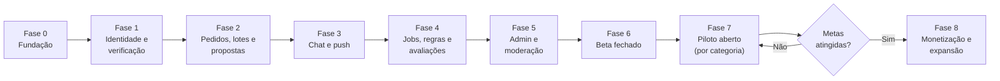

# ROADMAP — Fases de Desenvolvimento

> Status: **Revisado pela auditoria (v2), pendente de aprovação**. Estimativas em semanas, com dedicação integral e agentes de IA. São **ordens de grandeza**, não promessas. Sem data-alvo (PRD D-07). Itens novos: **[PENDENTE DE APROVAÇÃO]**.

## Visão geral

| Fase | Duração | Entregável | Critério de saída |
|---|---|---|---|
| **0. Fundação** | 1 a 2 sem | Documentação aprovada, repositório, ambientes, CI (tipos, lint, testes, **verificação de RLS e de testes por tabela**), migrações base, tokens de design, contas de loja iniciadas | Build roda no dispositivo. CI verde. Harness de teste de banco funcionando |
| **1. Identidade e verificação** | 3 sem | Cadastro, login, OTP, `consent_records`, perfis, onboarding do prestador, upload por URL assinada, submissões de verificação, **admin mínimo para aprovar/rejeitar** (E8-01..03), recurso, purga de arquivos, categorias/bairros (seed) | Prestador é aprovado de ponta a ponta. Documentos inacessíveis a não-admin (testado). Purga funcionando |
| **2. Pedidos, lotes e propostas** | 3 a 4 sem | Criar pedido, **elegibilidade e despacho em lotes**, `request_matches`, propostas (limite com lock, edição, retirada), comparar, aceitar, expiração preguiçosa + cron | Fluxo ponta a ponta no staging. Testes de concorrência e de expiração verdes |
| **3. Chat e notificações** | 2 sem | Chat em tempo real via `send_message`, push genérico com teto diário e `can_interact`, central de notificações | Push em Android e iOS reais. Bloqueio impede mensagem |
| **4. Jobs, regras e avaliações** | 3 sem | Agendamento por aceite, cancelamento, não comparecimento, conclusão (parcial), disputa, avaliação bilateral com revelação e janela, métricas | Todas as transições do DATABASE seção 5 testadas |
| **5. Admin, moderação e conta** | 2 a 3 sem | Fila de denúncias e disputas, usuários, categorias com **gate**, indicadores, auditoria, bloqueio e denúncia no app, **exclusão de conta** | Operador modera sem tocar no banco. Exclusão validada com varredura de PII |
| **6. Beta fechado** | 2 a 3 sem | Builds de teste, 10 a 20 prestadores indicados, usabilidade e acessibilidade | Sem bugs críticos. Funil medido |
| **7. Piloto aberto em Osasco** | 8 a 12 sem | Publicação nas lojas, aquisição de prestadores, **abertura de cada categoria quando passar o gate**, operação manual | Metas do PRD seção 7 |
| **8. Monetização e expansão** | A definir | Decisão de modelo, pagamentos se for o caso, PostGIS, novas cidades/categorias | Decisão baseada em dados |

## Metas harmonizadas (**decisão aprovada**)

- **Por categoria (gate de abertura aos clientes):** ≥ 2 prestadores aprovados e disponíveis (decidido pelo proprietário para acelerar o início da validação prática em Osasco).
- **Piloto global:** ≥ 30 prestadores verificados no total ao longo da expansão das 4 categorias, ≥ 100 pedidos, ≥ 60% com proposta em 2h, ≥ 25% aceitos.
- Cada categoria pode ser ativada de forma independente assim que alcançar seus primeiros 2 profissionais verificados.

## Caminho crítico e atrasos prováveis

1. **Aprovação das lojas** (Apple, em especial): iniciar as contas na Fase 0. Exigem exclusão de conta, denúncia, bloqueio e declaração de privacidade coerente com a coleta de selfie/documento.
2. **SMS/OTP:** provedor e custo (PRD D-04). Testar cedo.
3. **Push no iOS:** certificados e build nativo. Testar na Fase 3.
4. **Revisão jurídica** (Termos, Privacidade, RIPD de dado biométrico): em paralelo às Fases 4 e 5. **Bloqueia o piloto aberto.**
5. **Verificação manual** é o gargalo operacional. O admin mínimo está na Fase 1 de propósito.
6. **Despacho em lotes e crons** exigem teste de concorrência cedo (Fase 2), não no fim.

## Estratégia de lançamento (aquisição fria)

- **Prestadores primeiro, por categoria.** Cada categoria só abre aos clientes ao passar o gate. Categorias que não atingirem permanecem "Em breve".
- Canais a investigar: grupos de bairro, associações de comércio, cursos profissionalizantes, presença física (QR em lojas de material de construção), indicação.
- Proposta ao prestador: sem custo, perfil verificado, pedidos locais.
- Clientes: grupos de bairro e condomínios.
- É operação, não código, e é o maior risco do projeto (R1).

## MVP vs. depois

| MVP (Fases 1 a 7) | Depois (Fase 8+) |
|---|---|
| Pedido, proposta, chat, aceite, avaliação | Pagamento in-app / escrow |
| Bairros em lista | Mapa, raio, PostGIS |
| Push | E-mail, WhatsApp, preferências |
| Admin básico com gate de categorias | Admin avançado, relatórios |
| Texto no chat | Imagens, áudio |
| 1 cidade, 4 categorias | Multi-cidade, Carpinteiro/Passadeira/Cozinheira |
| Verificação manual de identidade | Verificação automática, antecedentes, competência |
| Agendamento por aceite | Agenda, recorrência |
| Direitos do titular por DPO manual | Exportação de dados automática |
