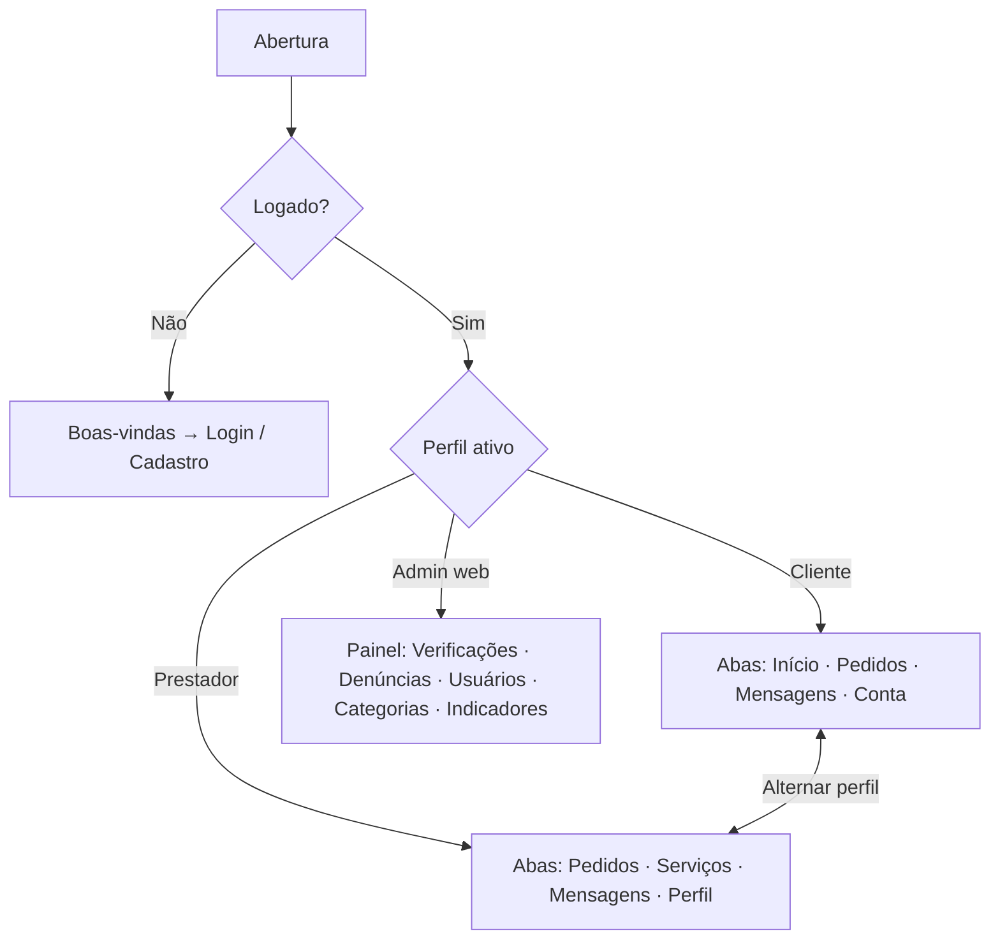
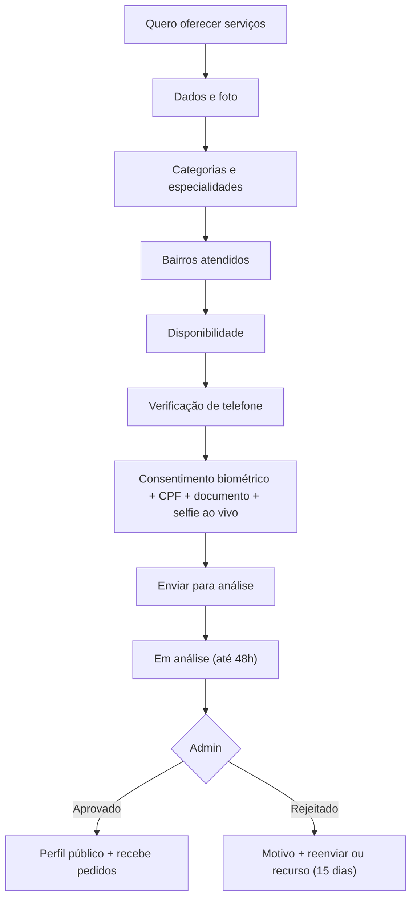
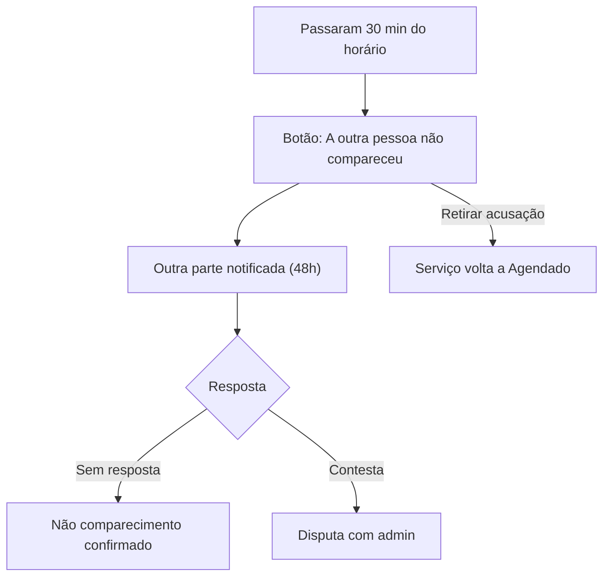

# USER_FLOWS — Fluxos de Navegação

> Status: **Revisado pela auditoria (v2), pendente de aprovação**. Fluxos em texto e diagramas; wireframes ficam para a fase de design. Itens novos: **[PENDENTE DE APROVAÇÃO]**. Ver [AUDIT_REPORT.md](AUDIT_REPORT.md).

## 1. Estrutura de navegação

## 2. Cadastro e autenticação

1. Boas-vindas, com "Entrar" e "Criar conta".
2. Cadastro: nome, e-mail, senha, aceite de Termos e Privacidade, declaração de 18+.
3. Confirmação de e-mail.
4. Verificação de telefone (OTP). Pode ser adiada até o 1º pedido (cliente) ou é obrigatória para virar prestador.
5. Escolha inicial: "Quero contratar" ou "Quero oferecer serviços". Dá para mudar depois.

Estados de erro: e-mail já cadastrado, OTP expirado, limite de tentativas, sem conexão.

## 3. Cliente

### 3.1 Criar pedido
1. **Início** → escolher categoria (grade de ícones com texto).
2. Descrever o problema (texto, fotos opcionais).
3. Bairro (padrão do perfil) e **janela de datas** desejada.
4. Endereço completo (explicação: *só será mostrado ao profissional que você escolher*).
5. Revisão e envio.
6. Tela de confirmação: *"Enviamos seu pedido para profissionais da sua região. Você recebe até 5 propostas em até 48h."* **O app não informa quantos profissionais foram avisados** (o despacho é em lotes e o número revelaria a oferta).

Caso sem prestadores elegíveis: mensagem honesta ("ainda não temos profissionais para esse serviço no seu bairro") e opção "Avise-me". Registra em `unserved_demand`.

### 3.2 Comparar e aceitar propostas
1. Push "Nova proposta".
2. Lista de propostas: preço, o que inclui, data proposta, nota, serviços feitos, selo, tempo de resposta. Ordenar por preço, nota ou rapidez.
3. Ver perfil do prestador, com portfólio e avaliações.
4. Conversar (chat) para esclarecer.
5. **Aceitar** → confirmação com resumo (valor, data, prestador) → agendamento criado, demais propostas recusadas com aviso gentil.
6. Aviso: *"O pagamento é combinado diretamente com o profissional."*

### 3.3 Acompanhar e concluir
1. **Pedidos** → abertos / em andamento / concluídos.
2. Prestador marca concluído → push ao cliente → tela de **avaliação** (1–5 estrelas + comentário opcional).
3. Se houver problema: botão "Algo deu errado" → denúncia ou contestação.
4. Cancelamento ou problemas: ver seção 11 (cancelar, não comparecimento, serviço parcial, disputa).

## 4. Prestador

### 4.1 Onboarding e verificação

- Prestador **não aprovado** pode preencher o perfil, mas **não recebe pedidos** nem aparece em buscas.

### 4.2 Receber pedido e enviar proposta
1. Push "Novo pedido em [bairro]".
2. Tela do pedido: descrição, fotos, bairro, janela de datas, "restam X vagas".
3. **Enviar proposta:** valor total, o que inclui, visita (se cobra), data/horário, validade.
4. Confirmação. Pode retirar a proposta enquanto não aceita.
5. Pedido que fechou (5 propostas, expirou, outro aceito): estado claro "Encerrado".

### 4.3 Executar e concluir
1. Proposta aceita → push → serviço aparece em **Serviços** com endereço completo.
2. Chat com o cliente.
3. Marcar **Concluído** → avaliação do cliente → aguarda a revelação das avaliações (ambas enviadas ou 7 dias).
4. Cancelar com motivo (impacta indicador de confiabilidade).

### 4.4 Gestão
- Pausar recebimento, editar bairros e disponibilidade, gerenciar portfólio, ver avaliações e histórico.

## 5. Chat

- Uma conversa por (pedido, prestador). Criada quando a proposta é enviada.
- Texto no MVP. Indicador de leitura. Push de nova mensagem.
- Aviso fixo: *"Por segurança, mantenha a conversa no app e não compartilhe senhas ou dados bancários."*
- Ações: denunciar, bloquear.

## 6. Avaliações

1. Liberadas quando o prestador conclui.
2. Cada lado avalia 1–5 e comenta (opcional).
3. As avaliações ficam ocultas até as duas serem enviadas ou até 7 dias.
4. Avaliação abusiva: qualquer parte pode denunciar. O admin pode remover.

## 7. Denúncia e bloqueio

1. Em perfil, mensagem, avaliação ou pedido → "Denunciar" → motivo → detalhes.
2. Confirmação ao usuário. Entra na fila admin (prioridade alta para relato de segurança física).
3. Bloquear: oculta o usuário e impede mensagem e novos pedidos entre os dois.

## 8. Admin (web)

1. **Verificações e recursos:** fila por data (análise inicial até 48h, recursos até 5 dias úteis), abrir documentos via URL assinada de 60 s (com motivo registrado em auditoria), conferir foto×selfie e CPF, aprovar/rejeitar com motivo padronizado (`rejection_reason`).
2. **Denúncias e disputas de serviço:** fila priorizada (`safety` ≤ 24h, normal ≤ 72h). Acesso a conversas ou mídia do pedido **somente com `report_id` vinculado** e auditado. Ações: arquivar, advertir, remover conteúdo, decidir resultado de disputa (`dispute_outcome`), suspender ou banir.
3. **Usuários:** busca, suspender/reativar, fila de revisão de cancelamentos tardios (≥ 3 em 30 dias).
4. **Categorias (com gate) e bairros:** painel exibe indicadores do gate (G1 a G4: aprovados, disponíveis, zonas, fila em dia) antes de ativar/pausar categoria.
5. **Indicadores e saúde operacional:** funil (pedidos → propostas → aceites → conclusões), prestadores por categoria, tempo de aprovação, demanda não atendida (`unserved_demand`), status de execução dos jobs agendados (`pg_cron`).

## 9. Conta

- Editar perfil, alterar senha, preferências de notificação (fase 2).
- **Excluir conta** (confirmação em 2 passos, explicação do que é apagado).
- Termos e Privacidade, Central de ajuda (link para contato por e-mail).

## 10. Estados vazios e erros (padrões)

- Sem internet: banner e reenvio automático.
- Listas vazias: texto orientando a próxima ação.
- Erro de servidor: mensagem amigável, botão "Tentar de novo", e registro no monitoramento.
- Sessão expirada: voltar ao login preservando o rascunho do pedido.

## 11. Fluxos de regras de negócio **[PENDENTE DE APROVAÇÃO]**

Estados e condições exatas: DATABASE seção 5. Parâmetros: PRD seção 11.

### 11.1 Cancelar serviço agendado
1. Serviço → "Cancelar" (disponível **antes** do horário).
2. Escolher motivo (lista). Se faltar menos de 24h, aviso: *"Cancelamento tardio será registrado."*
3. Confirmar. A outra parte recebe push. O pedido encerra como cancelado.
4. Cliente vê **"Repetir pedido"** (novo pedido pré-preenchido). Não há reabertura.

### 11.2 Não comparecimento

Ambas as partes veem a situação em "Serviços". Avaliação liberada em caso confirmado.

### 11.3 Concluir (inclui parcial)
1. A partir do horário, prestador → "Concluir".
2. Escolhe **Completo** ou **Parcial** (nota obrigatória no parcial: *o que foi feito e o que faltou*).
3. Cliente recebe push, vê a nota e pode **avaliar** ou **"Algo deu errado"** (disputa) em até 7 dias.
4. Sem desfecho 7 dias após o horário: serviço cancelado automaticamente e sem avaliações. Lembrete às duas partes após 24h.

### 11.4 Disputa (inclui divergência de valor)
1. "Algo deu errado" → motivo (serviço incompleto, valor diferente do orçamento, não compareceu, dano ou roubo, ameaça, outro) + detalhes.
2. Confirmação: *"Vamos analisar em até 72h. Casos de segurança têm prioridade."* O aviso informa que a plataforma **não media pagamentos nem reembolsos**.
3. Avaliações do serviço ficam suspensas até a decisão.
4. Admin decide o resultado do serviço e aplica moderação. As duas partes são notificadas.

### 11.5 Recurso de verificação
1. Rejeição: motivo + opções "Reenviar documentos" ou "Recorrer" (prazo de 15 dias, uma vez).
2. Recurso: texto curto + documentos opcionais. Status "Recurso em análise" (até 5 dias úteis).
3. Decisão final: aprovado, ou rejeitado definitivamente.

### 11.6 Bloqueio
- Bloquear a partir de perfil, conversa ou pedido. O bloqueado não é avisado.
- A partir daí: sem mensagens, sem novas propostas, sem aceite de propostas entre as duas partes, perfis se ocultam, conversas ficam somente leitura.
- Denunciar continua possível. Serviço já agendado segue (pode ser concluído ou cancelado). O app sugere denunciar se houver risco.

### 11.7 Excluir conta
1. Conta → "Excluir conta" → reautenticação.
2. Se houver serviço agendado, em disputa ou denúncia aberta contra você: bloqueado, com mensagem explicando como resolver.
3. Caso contrário: aviso do que será apagado e do que será mantido de forma anonimizada. Confirmação em 2 passos.

### 11.8 Pedido sem profissionais na região
Mensagem honesta. Opção **"Avise-me"** quando houver profissionais **[PENDENTE DE APROVAÇÃO]**. O pedido encerra como "sem profissionais disponíveis".
